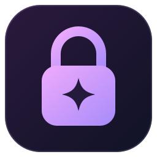
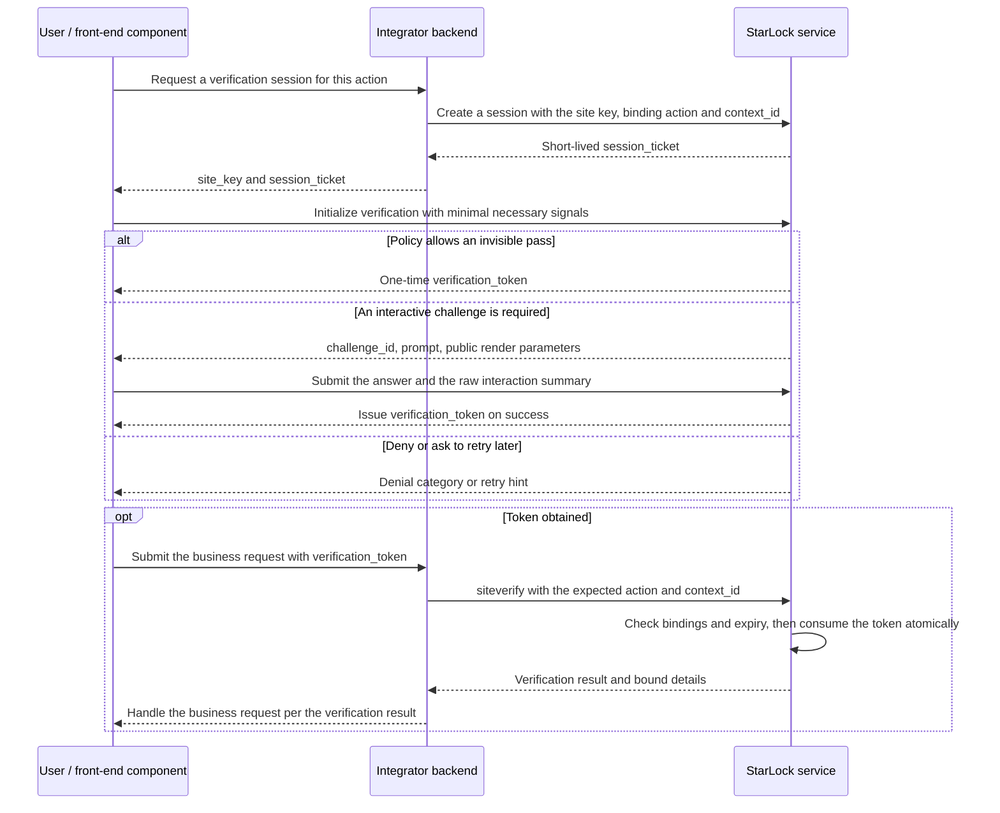

<p align="center"><a href="README.md">中文</a> · <b>English</b></p>

<p align="center">
  <a href=".github/assets/starlock.svg">
    
  </a>
</p>

# StarLock

A human-verification service for websites and web applications. It provides a hosted front-end component, a server-side verification API, and site configuration. The current release supports eight challenge types — digits, alphanumeric, arithmetic, straight-line puzzle slider, curved puzzle slider, ring rotation, text ordering, and semantic grid — for sign-up, sign-in, sending verification codes, comments, and sensitive operations.

The product direction follows Google reCAPTCHA and hCaptcha: risk assessment decides whether interaction is required, and the scenario decides which challenge fits. StarLock is an independent implementation and does not claim protocol or security parity with any third-party product.

> Current version: `0.8.0`, local development build. Python + FastAPI + Redis provide the verification API, and the hosted `api.js` provides the eight challenge interfaces. Sliders support independent cubic-bezier speed easing, coordinated rotation, four shapes, and multiple decoy notches; the Vue 3 and React components reuse the same remote SDK through a loader. Cross-origin challenge endpoints are authorized per site origin, and the flow keeps session creation and token verification on the integrator's backend. Text ordering and the static semantic grid are implemented; multi-round image grids, invisible risk scoring, and behavioral scoring are still to come. A static interactive demo is published on Pages and decides answers in the browser. The production verification API, npm packages, and CDN are still pending deployment.

[Live demo](https://stardreamtech.github.io/projects/starlock/demo/) · [Project page](https://stardreamtech.github.io/projects/starlock/) · [Integration guide](docs/integration.md) · [Vue example](docs/examples/VueIntegration.vue) · [React example](docs/examples/ReactIntegration.tsx) · [Python / Go SDK](docs/server-sdks.md) · [Verification record](docs/verification.md)

Most design documents under `docs/` are currently written in Chinese.

## Live demo

Open the [eight-challenge interactive demo](https://stardreamtech.github.io/projects/starlock/demo/); it starts on the ring rotation challenge. Click a challenge type to switch inside a compact popup, with refresh, typing, dragging, and keyboard nudging. The demo reuses the project's challenge UI and client and judges published sample challenges in the browser. In real integration, the backend creates the session, checks the answer, and verifies the token.

The static demo source lives in `examples/static-demo/`; `npm run dev:demo` starts it on its own. See the [demo notes](examples/static-demo/README.md) for build and publishing steps.

## Running locally

Requirements: Python 3.12, Node.js 22.12+ or a recent LTS, npm, uv, and Docker (or your own Redis 7+). From the repository root:

```bash
uv venv --python 3.12 .venv
uv pip sync --python .venv/bin/python server/requirements.lock
npm ci
docker compose up -d redis
env STARLOCK_DEBUG=1 .venv/bin/python server/cli.py init-db
env STARLOCK_DEBUG=1 STARLOCK_DEMO=1 .venv/bin/uvicorn --app-dir server main:create_app --factory --host 127.0.0.1 --port 8018 --no-proxy-headers
```

In another terminal:

```bash
npm run dev
```

Open the [local demo](http://127.0.0.1:5178/); the ring rotation challenge is selected by default, and clicking a challenge type or the card opens it in a popup. The home page hero does not auto-open, while entering `#experience` directly expands the default challenge. After the drag or typed answer, the site calls the demo backend for verification and shows the completed state — no separate "start verification" click or extra submit step. The page never shows answers or the site secret. Those local addresses refer to the machine running the project services.

`npm run dev` builds the hosted script first. Run `npm run dev:hosted` in another terminal to reach the [standalone page integration example](http://127.0.0.1:5179/): it loads the script from `8018` and requests challenges cross-origin, without bundling Vue or the challenge UI. The React example is at [react.html](http://127.0.0.1:5179/react.html) and also uses the real backend for sessions and token verification. After changing hosted components, run `npm run build:sdk` again and reload the page.

Redis listens on `127.0.0.1:6391` only, on DB 0 by default. Tests use randomly named namespaces and never flush existing Redis data. Stop Redis with `docker compose stop redis`; stop the two processes with `Ctrl+C`.

```bash
uv pip sync --python .venv/bin/python server/requirements-dev.lock
env PYTHONPATH=server .venv/bin/python -m unittest discover -s server/verification/tests -v
npm test
npm run build
```

Local configuration uses the published development HMAC key and only activates when `STARLOCK_DEBUG=1` is set explicitly. Non-development mode requires `STARLOCK_SECRET_KEY` from the environment and rejects the public development value. `STARLOCK_DEMO=1` registers `/demo/*` only in debug mode; production integrations must not use that demo backend. In debug mode the [API docs](http://127.0.0.1:8018/docs) are available; non-development mode disables interactive docs and the OpenAPI route.

The project site uses the StarLock purple lock logo, a deep-purple and mist-white brand palette, a full lock-body scene, and sans-serif typography, with advanced and basic challenge types grouped separately. Fast switching only honors the last selection; the development demo serializes session and verification requests per page so a stale response cannot overwrite the context cookie. The SDK still hands the token back through the success callback and never submits real business actions for the integrator.

The site build includes static prerendering, so the initial HTML carries product copy, integration notes, and documentation links. The public project page is published on StarDream Tech Pages with canonical links, structured organization and project data, a sitemap, and a documentation index. [StarLock project page](https://stardreamtech.github.io/projects/starlock/)

Once the standalone site has its own domain, set `STARLOCK_PUBLIC_URL` to the HTTPS root at build time; the build then generates the canonical URL, share URL, `robots.txt`, and `sitemap.xml`. Without it, the build keeps `noindex` for local preview so the production domain can establish its own index later.

```bash
STARLOCK_PUBLIC_URL=https://verify.example.com/ npm run build
```

That domain is a configuration example. Real search indexing and AI citation behavior must be observed after publishing.

In development, Vite proxies `/sdk`, `/v1`, and `/demo` to FastAPI; the standalone page example proxies only the demo business endpoints while challenge endpoints are called cross-origin. SQLite still stores local site data and stays compatible with existing PBKDF2 key records. The full site console, production database deployment, TLS/gateway, key rotation endpoints, and capacity and detection-quality evaluation are not done. [Modules and integration](docs/implementation.md) records the current limits and the extension order.

### Project site and front-end integration

The project site covers the product introduction, live experience, and developer docs, with a site console to follow. The existing `examples/playground` is the first local version of that site: a branded home page, a real verification experience, and a developer integration area. It can be built to static files, though the live experience still needs the backend. The production domain, standalone documentation routes, and console are not live yet.

The recommended delivery is a **hosted script plus a standalone verification API**, with the Vue and React packages handling loading, mounting, and callbacks. Challenge UI updates ship in our hosted script, so integrator pages never bundle the challenge. The API does not generate JavaScript per verification.

- A plain page loads `/sdk/v1/api.js` and calls `window.StarLock.render(container, options)`. The script bundles the Vue runtime, so hosts need no Vue install, and Shadow DOM isolates styles.
- Vue 3 uses `@starlock/vue`; React 18/19 uses `@starlock/react`. Both accept `sdkUrl` and reuse the same remote script. The npm packages are still private workspace sources and cannot be installed from npm yet.
- The hosted component shows a popup by default: the page only holds a compact verification card, while the challenge lives in its own Shadow DOM and a top-layer dialog under `body`, so it never reflows the host form. `displayMode: 'inline'` keeps the older embedded layout.
- The component's `apiBase` defaults to the script's origin; set it explicitly when script and API are deployed separately. `apiBase: ''` uses the host's same-origin `/v1/*`, and `'/starlock'` works behind a same-origin gateway that strips the prefix.
- Cross-origin challenge requests are authorized by the exact Origin of enabled sites. Preflight allows only POST and Content-Type, sends no cookies, and never exposes backend admin endpoints. Production external addresses use HTTPS; the internal `8018` port is forwarded by a gateway.
- `site_key` may be public; `site_secret` lives only on the integrator's backend. After the front end receives a token, the backend must still call `/v1/siteverify`.

The [site plan and full integration guide](docs/integration.md) covers component examples, address conventions, deployment boundaries, and the delivery order.

### Python and Go backend integration

A Python synchronous SDK and a Go SDK are available in `sdks/python` and `sdks/go`. Both use only the standard library and wrap session creation, the eight challenge-type parameters, one-time token verification, timeouts, and typed errors; Go accepts a context and can be reused concurrently.

Install Python from this repository:

```bash
pip install ./sdks/python
```

Install Go from the source branch:

```bash
go get github.com/StarDreamTech/starlock/sdks/go@main
```

The integrator backend stores the action and context, creates a session, and hands the ticket to the HTML, Vue, or React component. When the front end finishes, the backend verifies the token and then performs the business action. The verification service currently runs on FastAPI, while integrations can use Python, Go, or any HTTP client. PyPI and Go version tags are not published yet. [Python / Go full guide](docs/server-sdks.md)

### React quick start

The repository's `@starlock/react` supports React 18.2+ and React 19. Once the backend has created a `session`, mount the component; `submitBusiness` stands for your own business submit function. Replace the example domain with your actual hosted address.

```tsx
import { StarLock } from '@starlock/react'

<StarLock
  siteKey={session.site_key}
  sessionTicket={session.session_ticket}
  sdkUrl="https://verify.example.com/sdk/v1/api.js"
  displayMode="popup"
  onSuccess={({ token }) => submitBusiness(token)}
/>
```

The component supports `onSuccess`, `onExpire`, `onError`, and `onClose`, and its ref exposes `open()`, `close()`, and `refresh()`. Changing the ticket or unmounting cleans up the old instance, while updating callbacks keeps the current challenge; StrictMode and SSR loading placeholders are covered by checks.

The React and Vue packages are workspace sources. After `npm run dev:hosted`, open the [React integration example](http://127.0.0.1:5179/react.html) to run a real challenge and backend verification. The [complete React example and configuration](docs/integration.md#react-接入) explains client boundaries, load retries, and callback handling.

### Current brand assets

- [StarLock logo · SVG](assets/brand/starlock.svg)
- [StarLock logo · PNG](assets/brand/starlock.png)
- [Wide glass lock hero visual](assets/brand/starlock-hero-v2.png)
- [Home page design and generation prompts](docs/home-design.md)

The page header, favicon, challenge UI, and standalone integration example all use the project's dedicated purple lock mark. Sources and earlier illustrations are in the [brand guidelines and asset record](docs/brand-assets.md).

## 1. Product positioning

StarLock delivers a verification service, not just captcha images or an interaction animation:

- **Front-end component**: challenge display, real user interaction, result callbacks, and error recovery on desktop and touch devices.
- **Verification backend**: challenge generation, answer storage, risk decisions, answer checks, and one-time token issuance.
- **Server verification endpoint**: called by the integrator's backend to confirm the token belongs to the right site, action, and business context before acting.
- **Site management**: sites, allowed domains, keys, verification policy, and basic statistics — minimal management first, then a console.

Core principle: disturb low-risk requests as little as possible and add interaction as risk rises; the integrator's server makes the final allow/deny decision from the verification result. A captcha is not authentication and never replaces sign-in, authorization, rate limiting, or transaction checks.

## 2. Challenge types and priority

| Type identifier | Interaction and capability | Development stage | Current status |
| --- | --- | --- | --- |
| `text` | Type the alphanumeric characters in the image | Stage 1 | Implemented, reorganized from the earlier generator |
| `digits` | Type the digits shown in the image | Stage 1 | Implemented, new dedicated type identifier |
| `arithmetic` | Type the result of the arithmetic expression | Stage 1 | Implemented, no `eval` |
| `color_text` | Enter the characters matching the color and prompt | Stage 1, optional | Generator exists in the legacy project; needs an alternative that does not depend on color |
| `duplicate_text` | Find the repeated characters the prompt asks for | Stage 1, optional | Generator exists in the legacy project; prompt and answer uniqueness still need checking |
| `rotate` | Drag-rotate the inner ring until it aligns with the fixed outer ring | Stage 2 | Implemented, bezier rotation speed and blurred seam |
| `slider` | The shape moves along a straight line with easing and rotation, fitting the only matching notch | Stage 2 | Implemented, bezier speed easing, four shapes, multiple notches |
| `bezier_slider` | The shape moves along a cubic bezier path with easing and rotation | Stage 2 | Implemented, independent space and speed curves, position and angle checks |
| `text_click` | Click three specified Chinese characters in the prompted order | Stage 3 | Implemented, scaled coordinate restore, order check, undo |
| `semantic_grid` | Pick every tile in a nine-tile grid that matches a question | Stage 3 | Implemented, static grid, random identifiers, set check |
| `invisible` | Risk decision in the background, escalating to a challenge when needed | Stage 4 | To be built: rules first, models later |
| `behavior` | Combine dragging, ordering, rotation, and behavioral signals per scenario | Later | Added by real need, not all at once |

"Invisible" is a trigger-and-escalation policy that can escalate to a slider, ordering, or grid challenge. It does not mean every request passes without interaction, nor that mouse trajectories alone reliably identify humans.

## 3. Unified verification flow

The integrator configures the allowed challenge types; the StarLock server combines that with policy to choose this request's challenge. A challenge-type preference from the browser cannot lower the strength the server requires.



- `site_key` is a public site identifier; `site_secret` is stored only on the integrator's backend.
- `action` names the business purpose, such as `register`, `login`, or `send_email_code`; site policy controls which actions are allowed.
- `context_id` is a random identifier the integrator backend generates and stores for this operation, bound to the business session and necessary request content. A value claimed by the client cannot be trusted.
- `session_ticket` starts a short-lived verification session bound to the site, action, and context; it is not a pass token.
- `verification_token` is the one-time token issued after a challenge or an invisible policy pass. The front-end success callback only means a token was obtained; the business action still needs server verification.
- Refreshing a challenge closes the old one; failed retries are limited by count and rate. After expiry or refresh, old answers and old traces cannot be used for the new challenge.

A session moves `created → active → passed → consumed`, and may also enter `expired` or `closed`. One session issues at most one pass token, after which it accepts no more challenge generation or answers; re-verification requires a new session. Tokens are opaque strings from at least 256 bits of secure randomness, and Redis stores their digest, bindings, and state.

The session-creation endpoint should reuse the integrator's existing session protection and rate limiting so it cannot become an unlimited ticket source. This first version establishes the trusted business binding this way; a simplified public initialization mode for low-risk cases can be evaluated later.

## 4. Migration from StarDream

### Verified sources

The reference local repositories are `StarDream` and `StarDream-frontend`. The paths below are the migration sources; StarLock has already organized independent character, arithmetic, and decoy-shape logic in `server/verification/generators.py` and does not need the old project to run.

| Source file | Existing content | Migration approach |
| --- | --- | --- |
| `StarDream/StarDreamCaptcha/captchas.py` | Pillow image generation, font loading, noise lines and arcs; four challenge types | Extracted into standalone generators, with the direct dependency on StarDream's global settings removed |
| `StarDream/StarDreamCaptcha/models.py` | Email-linked answers, creation time, verified flag; 5-minute validity | Lifecycle used as reference, reworked into short-lived challenges bound to site, session, and challenge_id |
| `StarDream/StarDreamCaptcha/views.py` | Random generation, image encoding, answer checks, display and test endpoints | Generation kept; re-wrapped under the unified protocol, with registration and email sending removed |
| `StarDream/StarDreamCaptcha/urls.py` | Django REST Framework routes | Inventoried as legacy endpoints, not used as StarLock's public protocol |
| `StarDream-frontend/src/views/app/StardreamCaptcha.vue` | Vue 3 + Vuetify type selection, image, and answer display page | Display approach used as reference, split into the verification component and an internal demo page |

Legacy type mapping: `alpha_numeric → text`, `arithmetic → arithmetic`, `color_letter → color_text`, `duplicate_color → duplicate_text`. `digits` is new, and the color and duplicate-character types are not migrated yet.

### Migration items handled and pending

1. **Separate demo and production endpoints**: the legacy `captcha_api` returned `text` and `answer`, and the demo page displayed them. Production returns only the prompt and render parameters. Internal debugging that needs the answer must run in a controlled development mode, never in production.
2. **Decouple business logic**: the old check depended on email, registration state, and mail sending. StarLock only returns a human-verification result; email, SMS, and registration stay with the integrator.
3. **Complete the lifecycle**: identify challenges by random `challenge_id` and apply expiry, attempt limits, and atomic state transitions; the old check-then-save code cannot serve as a concurrency-safe one-time guarantee.
4. **Protect answers**: remove answer printing and objects containing answers. Low-entropy character answers use HMAC material with a server key rather than an ordinary hash that can be enumerated offline. Raw text and answers never enter public responses or routine logs.
5. **Separate randomness purposes**: sessions, challenge identifiers, tokens, and answers use a secure random source; purely visual noise may keep ordinary randomness. Arithmetic results are computed explicitly, and the existing `eval` was removed during migration.
6. **Check generation quality**: add font distribution licensing and missing-font handling, character clipping, color contrast, expression readability, and answer-uniqueness checks. Color challenges must provide an alternative path.

The legacy registration, email, answer display, and global-settings coupling are gone, replaced by secure randomness, HMAC answer material, and atomic Redis state changes. Classic input challenges use Pillow's bundled fonts, and text ordering uses Noto Sans SC shipped with the server (SIL OFL 1.1); color challenges and deeper font-quality checks remain for later. The old repository was not modified.

## 5. Proposed technical design and module boundaries

Following the confirmed option A, the verification service uses FastAPI + Pydantic + Uvicorn, Pillow for images, and Redis for short-lived state. Generators and the verification state machine are independent of the web framework; the Django/DRF runtime code and dependencies are removed, and old StarDream remains only as a migration record.

| Layer | Proposed approach | Responsibility |
| --- | --- | --- |
| Browser SDK | TypeScript + isolated style scope | Initialization, challenge rendering, input capture, callbacks, teardown, and re-verification |
| Framework components | Vue 3 and React 18/19 wrappers | Reuse the hosted SDK and handle framework lifecycles |
| Verification API | FastAPI + Pydantic + Uvicorn | Sessions, generation, checks, tokens, request validation, and development API docs |
| Image generation | Pillow | Character images, puzzle assets, and prompt composition |
| Short-lived state | Redis | Sessions, challenges, tokens, attempt counters, rate limiting, and atomic consumption |
| Persistent data | Standard-library `sqlite3` for now; deployment database separate | Keeps the existing site table and key derivations; tenants, policy versions, and aggregate stats are pending |
| Image assets | Local directory during development, object storage as needed after deployment | Stores base assets with clear provenance; challenge assets expire and are cleaned up |

Start with one backend service and one SDK closing the loop. Complex scoring models, a dedicated risk cluster, other framework wrappers, and multi-region deployment wait for real demand and data.

Current module layout:

```text
server/main.py          FastAPI application factory entry
server/cli.py           Site table init, create, and disable commands
server/config/          Standalone runtime configuration
server/verification/    Generators, sites, challenge and token services, API, controlled demo, tests
packages/core/          Framework-free TypeScript client and lifecycle tests
packages/browser/       Hosted component, Shadow DOM mounting, remote script loader, IIFE build
packages/vue/           Vue 3 loader wrapper for the hosted SDK
packages/react/         React 18/19 loader wrapper for the hosted SDK
examples/playground/    StarDream-branded demo site with Vite same-origin proxy
examples/hosted/        Framework-free cross-origin page integration example
assets/brand/           Standard StarLock logo and site brand illustrations
assets/rotation/        The original three brand rotation assets
server/assets/          Twenty new system assets, image-set manifest, and admin page
docs/                   Module boundaries, integration, brand prompts, and verification records
```

## 6. Current API and future protocol

The four APIs below are implemented. `/v1/challenges` currently always returns `decision: challenge` and supports `text`, `digits`, `arithmetic`, `slider`, `bezier_slider`, `rotate`, `text_click`, and `semantic_grid`; it does not accept a client lowering the challenge strength. `pass`, `deny`, and risk escalation policy remain future design. The [current call examples](docs/implementation.md) work for local integration.

### API

| Method and path | Caller | Input and result |
| --- | --- | --- |
| `POST /v1/sessions` | Integrator backend with the site secret | Creates a session bound to `action` and `context_id`, returns `session_ticket` |
| `POST /v1/challenges` | Browser SDK | Sends `site_key` and the session ticket; currently returns `challenge`; pass and deny policies are pending |
| `POST /v1/challenges/{challenge_id}/verify` | Browser SDK | Sends the same session ticket plus this challenge's answer and interaction data; issues a one-time token on success |
| `POST /v1/siteverify` | Integrator backend with the site secret | Checks and consumes the token, comparing it with the expected action and context from the server |

Creating a new challenge may include `replace_challenge_id`; the server checks ownership and closes the session's previous challenge. The first version allows one active challenge per session; after a timeout, create a new session.

Example structure of a bezier challenge (identifiers are examples and the Base64 PNG bodies are omitted; this is not a submittable challenge):

```json
{
  "decision": "challenge",
  "challenge_id": "ch_example",
  "challenge_type": "bezier_slider",
  "expires_in": 120,
  "payload": {
    "instruction": "Drag the slider so the shape's position and angle both fit the notch",
    "image": "data:image/png;base64,<challenge PNG>",
    "image_width": 320,
    "image_height": 180,
    "piece_image": "data:image/png;base64,<transparent puzzle PNG>",
    "piece_width": 64,
    "piece_height": 64,
    "path": {
      "kind": "cubic_bezier",
      "control_points": [{"x": 8, "y": 80}, {"x": 90, "y": 12}, {"x": 180, "y": 105}, {"x": 248, "y": 55}]
    },
    "motion": {
      "easing": {"kind": "cubic_bezier", "control_points": [{"x": 0.42, "y": 0}, {"x": 0.58, "y": 1}]},
      "rotation": {"start_degrees": -80, "end_degrees": 60}
    }
  }
}
```

`image` and `piece_image` are per-challenge PNG data URLs. The `path` control points use source-image pixel coordinates and describe the piece's top-left position before rotation; a straight slider has `path.kind` `linear` with two control points. `motion.easing` uses two control points in the unit square with fixed endpoints `(0,0)` and `(1,1)`; `rotation` describes the angle along the way, positive clockwise. Public prompts contain no correct progress, target notch identifier, target position or angle, or tolerance; multiple notches exist only in the image.

Verification requests reuse `site_key` and `session_ticket`. For text challenges, `answer` is a string; for sliders, `answer` is `{ "progress": 0.62 }` — the handle's raw progress, which must be within `[0,1]` and must not be the eased progress, so the backend does not ease it twice. The `0.62` here is only an example; clients cannot override targets, paths, speed curves, angles, or tolerances.

Example success response from verification:

```json
{
  "success": true,
  "site_key": "site_demo",
  "action": "register",
  "context_id": "ctx_demo_001",
  "hostname": "app.example.com",
  "challenge_type": "bezier_slider",
  "verified_at": "2026-11-14T08:00:00Z"
}
```

`hostname` should come from site configuration and server-side session binding, used alongside browser origin checks; an arbitrary string reported by the browser is not origin proof. `siteverify` checks every binding before consumption and rejects cross-site, cross-action, or mismatched-context tokens.

Error responses consistently use `error_code`, a user-appropriate `message`, and `request_id`, distinguishing `CHALLENGE_EXPIRED`, `ANSWER_INVALID`, `ATTEMPTS_EXCEEDED`, `TOKEN_USED`, `TOKEN_INVALID`, `CONTEXT_MISMATCH`, and `RATE_LIMITED`. Public responses never expose internal risk rules; rate-limited responses return a retry hint. If scoring opens up later, its direction, version, and calibration must be defined.

### Current SDK

- Hosted entry: `window.StarLock.render(container, { siteKey, sessionTicket, apiBase?, onSuccess?, onExpire?, onError? })`, returning `getResponse()`, `open()`, `close()`, `refresh()`, `reset(sessionTicket?)`, and `destroy()`. A container mounts once and can mount again after teardown.
- Vue / React options: `siteKey`, `sessionTicket`, optional `sdkUrl`, `apiBase`, CSP `nonce`, `displayMode`, and `autoOpen`. A page shares one script load, and a failed load can be retried; language configuration is not implemented.
- TypeScript core: `StarLockClient.initialize()`, `refresh()`, `verify(answer)`, `reset(sessionTicket?)`, `subscribe(listener)`, and `destroy()`; the core handles state and requests while the Vue component renders.
- Core callbacks: `onSuccess({ token, expiresIn })` and `onExpire()`; errors come from `errorCode` and `message` in subscribed state. The Vue component emits matching events, React uses `onSuccess`, `onExpire`, `onError`, and `onClose` props, and the ref exposes `open()`, `close()`, and `refresh()`.
- Component states: `idle → loading → ready → verifying → success`, plus `error`, `expired`, and `destroyed`; repeated actions never cause duplicate business submits.
- `reset(sessionTicket?)`: with a new ticket it reinitializes; without one it refreshes the active session's challenge. When a session has passed or expired, the integrator backend must create a new session. `destroy()` cancels requests and clears subscriptions and timers. A server-side session-close admin endpoint is not implemented, and destroying the component does not revoke an issued token.

## 7. Straight and bezier sliders (implemented)

### Interaction and coordinates

The backend generates a random starfield challenge per attempt. The user drags the handle horizontally; the shape moves along a straight line or a cubic bezier path while an independent bezier easing changes its speed and it rotates. Each challenge uses a puzzle piece, star, square, or rectangle, with 2–3 notches, only one of which matches both position and angle. Releasing the mouse or finger submits; the keyboard nudges with arrow keys, steps with PageUp/PageDown, jumps to the ends with Home/End, and confirms with Enter or Space.

```text
u = clamp(progress at press + pointer horizontal delta / (track width - handle width), 0, 1)
Speed easing: solve E_x(s) = u, giving t = E_y(s)
Straight position: P(t) = (1-t)·P0 + t·P1
Curve position: B(t) = (1-t)^3·P0 + 3(1-t)^2·t·P1 + 3(1-t)·t^2·P2 + t^3·P3
Rotation angle: angle = start_degrees + t·(end_degrees - start_degrees)
```

- **Path and speed are independent**: in `slider` the spatial track is always a straight line, and dragging at constant speed makes the shape accelerate and decelerate along the easing curve; `bezier_slider` uses a curved spatial path with its own speed easing. This maps drag progress to motion progress, so the shape stops when the user stops and never slides to the answer after release.
- **Easing semantics**: identical to CSS `cubic-bezier(x1,y1,x2,y2)` — solve for x, then compute y. The three current easings are slow-in, fast-in, and slow-at-both-ends; control points stay within `[0,1]` and monotonic to prevent overshoot. Front and back ends check against the same [math fixtures](fixtures/slider-motion.json).
- **Rotation and sizing**: the base image is `320 × 180`, the piece's transparent canvas is `64 × 64`, and the piece rotates around the canvas center. Shapes keep rotation padding and are downsampled from 4× to reduce jagged edges. Path control points and the whole path stay inside the movable area, and the rotated visible shape is never clipped.
- **Random constraints**: the handle target is limited to 35%–85%; the straight-line distance from start to target is limited to 96–204 source pixels. The canvas keeps at least 8 pixels at the edges, and notches stay at least 10 pixels from the starting piece's bounding box. Only qualifying candidates are chosen, excluding layouts that are too short, too far, out of bounds, or overlapping.
- **Decoys**: at least one decoy notch lies on the reachable path but with a mismatched angle; more decoy notches of a different shape are added when space allows. Notches share the same style, and public parameters never mark the correct one.
- **Scaling**: the display keeps its aspect ratio, the piece is positioned with `(x/W × 100%, y/H × 100%)`, sized proportionally to the source image, and then rotated. Browser zoom and DPR are not multiplied into pointer coordinates.
- The handle keeps the offset where it was pressed, using Pointer Events and pointer capture, and touch scrolling is disabled inside the handle. A layout resize during a drag cancels that drag; cancellation, extra fingers, and teardown never submit.
- Vue updates the piece position and never fills in the answer or fabricates a trace. A wrong answer resets the start, a refresh generates a new challenge, and after a timeout or exhausted attempts the controls disable while the user can refresh or rebuild the session.
- Interaction is enabled only after both images load; a load failure shows a refresh hint. The slider is keyboard-operable, but a full non-visual alternative for visual challenges is still to come.

### Server-side verification

The server keeps the random target position, target angle, position tolerance of `4` source pixels, and angle tolerance of `5°` in Redis and never sends them down. The front end submits only the handle's final progress; the backend recomputes position and angle from the stored easing, path, and rotation, and passes only when both match. Angle comparison accounts for each shape's symmetry period: `72°` for the star, `90°` for the square, `180°` for the rectangle, and `360°` for the puzzle piece. Session binding, expiry, the three-attempt limit, invalidation on refresh, atomic issuance, and one-time verification still apply.

Position and angle challenges plus the lifecycle are done; behavioral traces are not collected, scored, or trained on, so we do not claim to identify real users, resist image recognition, or match third-party risk-control results. A later behavior module will define its input signals, data limits, and evaluation method.

When upgrading, deploy the backend and the `0.8.0` SDK together and refresh caches; the old `0.4` SDK does not understand speed and rotation, and the `0.5` SDK lacks the ring challenge. The new SDK and backend still handle older challenges without `motion` or angle answer material, computing them as constant speed and zero rotation.

Existing sites do not gain challenge-type authorization automatically. Update explicitly as needed (replace `site_example` with your own public site identifier; the list replaces the previous grant):

```bash
env STARLOCK_DEBUG=1 .venv/bin/python server/cli.py set-site-types site_example --challenge-type text --challenge-type digits --challenge-type arithmetic --challenge-type slider --challenge-type bezier_slider --challenge-type rotate --challenge-type text_click --challenge-type semantic_grid
```

New sites allow the current eight types by default, or `create-site` narrows the set by repeating `--challenge-type`. Both local demo sites explicitly enable all eight; other existing sites keep their original grants.

### Ring rotation (`rotate`)

The ring challenge uses the same session, progress-answer, and token protocol. The prompt is a `256 × 256` outer-ring PNG and inner-ring PNG, with `piece_width/height` matching the source image; the outer ring is fixed and the inner ring rotates around the center. The correct correction angle is random within `75°–285°`, pre-rotated into the inner image and never sent in JSON.

`motion.rotation` maps `0° → 360°`, with an independent bezier easing from the handle's raw progress to the displayed angle; the backend re-applies the same easing and compares circular angle distance within `5°`. The inner ring never snaps to the correct angle.

Images come from two sources, configured by the business backend as `rotation_source` in `POST /v1/sessions`, and only for `challenge_type: "rotate"`:

- **`preset` (default)**: randomly chosen from the admin default image set (`23` images in `5` system sets at release, with custom uploads supported), featuring the StarLock purple lock body, four-point star keyhole, and star trails. Each challenge first rotates the whole image randomly, then generates an independent inner correction angle; completing it means aligning the two layers, not pointing the lock body upward.
- **`procedural`**: keeps the earlier random geometric patterns, generating per-challenge colors and an asymmetric band crossing the seam.

Refresh keeps the session-bound source; the browser challenge endpoint does not accept a source override. The site, plain page, and React example offer both sources, and the SDK's integration parameters are unchanged. [Asset sources, originals, and prompts](docs/rotation-assets.md). Assets may be published with the source, and a larger library does not prove resistance to recognition.

**Image-set management is implemented**: the [local admin page](http://127.0.0.1:8018/admin) supports system and custom sets, creating and renaming, bulk upload, deduplication, enabling whole sets or single images, and choosing the default set. The business backend can pass `image_set_id` for rotation and both slider challenges; the front-end SDK interface is unchanged. Upload limits, admin authentication, backups, and call examples are in the [image-set guide](docs/image-sets.md). This is an operator console for the service owner; customer accounts and a multi-tenant site console are still to come.

The seam gets only light blur across a band of roughly 10 pixels, with a feathered inner edge and a 3-pixel outer overlap to avoid a white gap; the whole image is never blurred. The current strength is a local baseline and has not been calibrated for human completion rate or recognition difficulty.

New sites include `rotate` by default; older sites must enable it with the full type list above. Local demo sites already have it. The site shows this challenge by default, and plain pages, Vue, and React all detect the prompt automatically with no extra front-end attributes.

## 8. Text ordering and semantic grid (implemented)

### Text ordering (`text_click`)

The prompt is a `300 × 180` PNG containing six distinct Chinese characters, and the instruction asks the user to click three of them in order. Positions, colors, and small rotations vary per challenge. The SDK shows numbered markers and supports removal, undo, clearing, and arrow-key/Enter operation.

The front end submits `0–1` normalized coordinates for the actual display size; the server maps them back to the source image and checks the specified order with a `27` source-pixel click tolerance. Target centers and tolerances live in private Redis answer data.

The snippet below only shows the answer field format; the coordinates are examples. Normal integration has the SDK submit them.

```json
{"answer":{"points":[{"x":0.2,"y":0.3},{"x":0.5,"y":0.7},{"x":0.8,"y":0.3}]}}
```

### Static semantic grid (`semantic_grid`)

The first version uses three checked categories — cars, boats, and fruit — with twelve images in total. Questions are semantic, such as "select all vehicles that can travel on water", with nine different images per challenge and two to four correct tiles. The SDK supports selecting, deselecting, clearing, and keyboard operation.

The server sends the question, `columns: 3`, and nine `{id, image}` entries, each with this challenge's random identifier and a JPEG data URL. Category, filename, source asset number, and the correct set stay on the server. The submitted set must match exactly; duplicates, unknown identifiers, extra or missing selections are rejected, and selection order does not matter.

The snippet below shows the answer format; actual identifiers come from the current challenge.

```json
{"answer":{"tile_ids":["tile_example_a","tile_example_b"]}}
```

Both challenge types reuse the three-attempt limit, expiry, refresh replacement, site/action/context binding, and one-time token verification. HTML, Vue, and React detect the new prompts automatically; deploy the backend and the `0.8.0` hosted SDK together. Older sites need the full type command from the previous section.

### Image sizes and asset scope

- The twelve new assets are stored as `768 × 768` JPEGs at about `64–133 KB` each. The grid sends `192 × 192` thumbnails at about `7–12 KB` each.
- Text-ordering prompts are about `12–15 KB`. The site hero uses roughly `36 KB` WebP, the three brand images ship as `51–77 KB` web versions, and the original illustrations are kept for server use and archiving.
- Pages loads one challenge at a time, fetches a new sample on refresh, and caches it for the current page, so a first visit does not download the whole public bank.
- The semantic bank uses a separate reviewed label list. The existing upload console serves rotation and slider image sets; custom labeling and an operator UI for semantic images are still to come.

Assets and prompts are in the [selection asset notes](docs/selection-assets.md). The twelve images validate the first version; human completion rates and recognition resistance need independent evaluation. Dynamic multi-round grids, shape ordering, and complex behavioral scoring are still to come.

## 9. Invisible verification and policy escalation

The first version uses explainable rules: combining site and action, request rate, session continuity, recent failures, network reputation, and the interaction signals the component needs, it returns `pass`, `challenge`, or `deny`. A successful component load, support for some browser API, or a single behavioral feature is never proof of humanity on its own.

Policy is configured per business scenario: sign-up, sign-in, and sending codes can differ, and the front end cannot choose a weaker policy. Escalation has count and time limits, and when a user cannot complete a challenge there must be a controlled alternative, rather than an endless stream of harder challenges.

Initially we only commit to building the rule flow, not to matching mature vendors' detection. Whether to add models depends on independently labeled data, business abuse outcomes, and a rules baseline evaluation.

## 10. Security, experience, and operational constraints

The following are overall design constraints. The current version implements the lifecycle, atomic consumption, site/action/context binding, basic rate limiting, input validation (including a 32 KiB limit on chunked requests), and local demo isolation; key rotation, a production gateway, and full accessibility alternatives are still missing, so this is not yet production-ready.

- **Lifecycle**: planned challenge validity of 120 seconds, at most 3 answer attempts per challenge, 120-second pass tokens, and 300-second sessions; all are server configuration and may be shortened, and a token never outlives its session. These are StarLock's initial design values and need adjustment with real integration data.
- **One-time consumption**: challenge pass, token issuance, and token consumption are atomic; concurrent verification of one token succeeds at most once. Refresh, retry, and concurrent requests all check state transitions.
- **Business retries**: integrators use `context_id` or a business idempotency key to avoid duplicate execution and store verification results to handle network retries. Once a one-time token is consumed, calling verification again cannot succeed. If a verification response is lost and its result unsaved, require re-verification.
- **Isolation and keys**: tenants, sites, and environments are separated; keys can be rotated and revoked, and the server stores only the secure derivations needed for verification. Production uses HTTPS throughout and never exposes keys in logs, URLs, or the browser.
- **Origins and assets**: allowed domains, Origin, CORS, and CSP together constrain legitimate integration; Origin/CORS is not server-side authentication. Image assets follow challenge validity and must not be reused through shared caches; the business server finishes verification with keys and context.
- **Rate limiting and cost control**: generation, refresh, failed attempts, sessions, and verification are limited separately, using site, session, and network information rather than IP alone; image generation and bank requests have resource caps.
- **Input validation**: limit request bodies, image sizes, event counts, and time spans; reject non-finite coordinates, out-of-range progress, invalid types, and implausible time series. Client time is only a signal; server time controls expiry.
- **Privacy**: collect only the signals this verification needs; never record what the user types in other fields, and never collect passwords or unrelated page data. Challenges and raw interactions are deleted with short-lived state in principle; troubleshooting samples need separate configuration, redaction, and a retention limit, and are never used for cross-site tracking.
- **Accessibility and touch**: support keyboard focus, readable status messages, large hit areas, touch cancellation, and retry; color, image, and drag challenges provide suitable alternatives, and reduced-motion preference never prevents completion.
- **Failure handling**: distinguish verification failure from service unavailability and return a retryable state. High-risk actions never auto-pass by default; if a low-risk action degrades, the integrator configures and records it in advance, and the SDK never silently declares success.
- **Test isolation**: later versions will offer test site configurations with fixed pass, fail, and expiry results, labeled as test environments and isolated from production keys; secret URLs or hidden parameters are never a production bypass.

## 11. Roadmap and acceptance

### Stage 1: migrate the base captchas and close the integration loop (minimal version done)

- Extract the four StarDream generators, delivering alphanumeric, digits, and arithmetic first; enable color types after readability and alternative-path checks.
- Implement site configuration, sessions, challenges, one-time tokens, and `siteverify`.
- Provide a browser SDK, a Vue 3 wrapper, and one integration example; keep demo and production endpoints separate.
- Acceptance: a real integrator backend can close the loop, and errors, expiry, refreshed old challenges, duplicate consumption, concurrent verification, and cross-site/action/context use are all rejected as expected.

### Stage 2: straight and bezier sliders (minimal version done)

- Implemented four shapes, straight/curved paths, independent bezier easing, rotation, multiple notches, and server position/angle checks; behavioral capture and scoring stay in stage 4.
- Accepted: a desktop cross-origin page and the 390-pixel site completed server verification for both sliders; automated checks cover three track widths, cancellation, and resizing. Real touch devices and a full high-DPI matrix still need verification; see the [verification record](docs/verification.md).

### Stage 3: ordering and grid (first version done)

- Implemented text ordering and the static semantic grid, reusing the server lifecycle, hosted SDK, and Pages demo.
- Checked normalized coordinates, order and set matching, error retries, refresh, expiry, random identifiers, and image sizes. Multi-round grids, more semantic categories, and a labeling console are still to come.

### Stage 4: invisible verification and risk-based escalation

- Establish a rules baseline, site policy, limited escalation, and basic observability, then evaluate models on data.
- Acceptance: report invisible pass rate, challenge trigger rate, completion rate, duration, and business abuse outcomes; never substitute interaction pass rate for real security, and never claim false-allow or false-block rates without labeled data.

## 12. How to verify future work

- Generators: character sets, arithmetic answers, uniqueness, missing fonts, and image boundaries.
- Protocol and security state: target parameters never leak, lifecycle, attempt limits, token binding, and concurrent one-time consumption; short-lived state checks use real Redis integration tests.
- Front-end interaction: mouse, touch, keyboard, scaling, refresh, timeout, duplicate submits, and teardown cleanup.
- Performance and quality: measure initialization latency, image generation time, verification latency, generation failure rate, and rate limiting separately, then establish initial capacity; create a baseline on agreed devices and networks before launch and never pre-write unmeasured QPS or availability promises.

Install, run, and test commands are at the top of this document. The [latest verification record](docs/verification.md) separates automated checks, browser checks, and unverified areas.

## 13. References

The following official documentation is useful for product and integration context; StarLock's own validity periods, challenge types, policy, and protocol follow the design above and later implementations.

- [Google reCAPTCHA v3](https://developers.google.com/recaptcha/docs/v3)
- [Google reCAPTCHA server verification](https://developers.google.com/recaptcha/docs/verify)
- [hCaptcha developer docs](https://docs.hcaptcha.com/)

## License

[MIT](LICENSE) © 2026 StarDreamTech.
