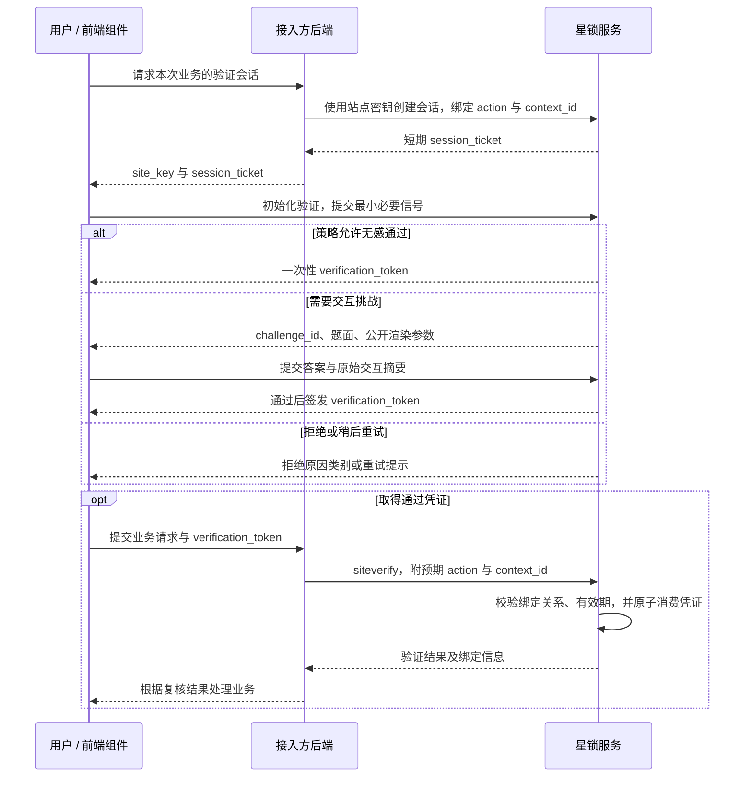

<p align="center">
  <a href=".github/assets/starlock.svg">
    
  </a>
</p>

# 星锁 · StarLock

面向网站与 Web 应用的人机验证服务，提供可嵌入的前端组件、服务端验证接口和站点管理能力。覆盖传统字符验证码、滑块、点选、九宫格及无感验证，让接入方通过同一套接口保护注册、登录、发送验证码、评论和敏感操作。

产品方向参考 Google reCAPTCHA 与 hCaptcha：以风险判断决定是否需要交互，再按场景选择合适的挑战。项目独立实现，不承诺与第三方产品的协议或安全能力等价。

> 当前版本：`0.7.0` 本地开发版。Python + FastAPI + Redis 提供验证 API，托管 `api.js` 提供圆环旋转、直线滑块、曲线滑块、数字、字符和算术六种验证界面。滑块支持独立贝塞尔速度缓动、同步旋转、四种图形及多缺口干扰；Vue 3 组件通过加载器复用同一份远程 SDK。已实现按站点来源授权的跨源挑战接口，保留业务后端创建会话与复核凭证的流程。点选、九宫格和无感风控仍属于后续阶段。尚未发布 npm、接入正式 CDN 或进行公网部署。

## 本地运行

需要 Python 3.12、Node.js 22.12+ 或较新的 LTS、npm、uv，以及 Docker（或自行提供 Redis 7+）。从本项目根目录执行：

```bash
uv venv --python 3.12 .venv
uv pip sync --python .venv/bin/python server/requirements.lock
npm ci
docker compose up -d redis
env STARLOCK_DEBUG=1 .venv/bin/python server/cli.py init-db
env STARLOCK_DEBUG=1 STARLOCK_DEMO=1 .venv/bin/uvicorn --app-dir server main:create_app --factory --host 127.0.0.1 --port 8018 --no-proxy-headers
```

在另一个终端运行：

```bash
npm run dev
```

打开 [本地演示](http://127.0.0.1:5178/)，默认选中圆环旋转；点击题型或验证卡，即在弹窗中打开。首页主视觉不自动弹出，直接进入 `#experience` 时自动展开默认题。拖动或输入答案完成挑战后，官网会自动调用演示业务后端复核，显示完成状态。无需点击“开始验证”或另行提交。页面不会展示答案或站点密钥。这里的地址指运行 OpenBot 的这台电脑上的本地服务。

`npm run dev` 会先构建托管脚本。另开终端运行 `npm run dev:hosted`，可访问 [独立网页接入示例](http://127.0.0.1:5179/)：页面从 `8018` 加载脚本并跨源请求挑战，接入页面本身不打包 Vue 或验证码界面。修改托管组件后需重新运行 `npm run build:sdk` 并刷新页面。

Redis 默认仅监听 `127.0.0.1:6391`；服务端默认使用该地址的 DB 0。测试用随机命名空间，不清空已有 Redis 数据。停止 Redis 可执行 `docker compose stop redis`，前后端进程可分别用 `Ctrl+C` 停止。

```bash
uv pip sync --python .venv/bin/python server/requirements-dev.lock
env PYTHONPATH=server .venv/bin/python -m unittest discover -s server/verification/tests -v
npm test
npm run build
```

本地配置使用已公开的开发用 HMAC key，仅在显式 `STARLOCK_DEBUG=1` 时启用。非开发模式必须从环境提供 `STARLOCK_SECRET_KEY`，不能使用公开开发值。`STARLOCK_DEMO=1` 只在 DEBUG 模式下注册 `/demo/*`；正式接入不能使用这个演示业务后端。开发模式下可打开 [API 文档](http://127.0.0.1:8018/docs)，非开发模式关闭交互文档与 OpenAPI 路由。

官网采用星锁专用紫色锁孔 Logo、暖纸与墨紫品牌视觉，进阶题型与基础题型分组展示。快速切换只显示最后选择；开发演示会串行处理会话与复核请求，避免同一页面的上下文 cookie 被旧响应覆盖。SDK 对外仍通过成功回调交还 token，不会替接入方自动提交真实业务。

官网开发环境由 Vite 将 `/sdk`、`/v1`、`/demo` 转发给 FastAPI，独立网页示例只代理演示业务接口，挑战接口跨源直连。SQLite 继续保存本地站点数据，兼容既有 PBKDF2 密钥记录。完整站点控制台、生产数据库部署、TLS/网关、密钥轮换接口、容量与识别效果评估尚未完成。[模块和接入说明](docs/implementation.md) 记录了当前限制与扩展顺序。

### 项目网站与前端接入

项目网站包含产品介绍、在线体验、开发文档，后续再加入站点控制台。现有 `examples/playground` 是官网的本地第一版，已经包含品牌首页、真实验证体验和开发接入区；它可以构建为静态文件，在线体验仍需要后端服务。正式域名、独立文档路由和控制台尚未上线。

推荐以 **托管脚本 + 独立验证 API** 交付，Vue 包负责加载、挂载和回调。挑战界面统一在我们的托管脚本中更新，接入方页面不需要打包验证界面。API 不在每次验证时生成 JavaScript。

- 普通网页加载 `/sdk/v1/api.js` 后调用 `window.StarLock.render(container, options)`。脚本包含 Vue 运行时，宿主无需安装 Vue；使用 Shadow DOM 隔离样式。
- Vue 3 使用 `@starlock/vue`，可配置 `sdkUrl`；该封装复用同一份远程脚本。npm 包仍为私有工作区源码，尚不能直接从 npm 安装。
- 托管组件默认以弹窗展示，页面只放一张紧凑验证卡，挑战挂在 body 下的独立 Shadow DOM 和顶层 dialog 中，不挤动业务表单。`displayMode: 'inline'` 可保留旧版嵌入方式。
- 托管组件的 `apiBase` 默认来自脚本地址；脚本与 API 分别部署时显式覆盖。`apiBase: ''` 则使用宿主同源 `/v1/*`，`'/starlock'` 可配合去除前缀的同源网关。
- 跨源挑战请求按启用站点的精确 Origin 授权；预检只允许 POST 和 Content-Type，不携带 cookie，也不开放后端认证接口。正式外部地址使用 HTTPS，内部 `8018` 端口由网关转发。
- `site_key` 可以公开；`site_secret` 只存在接入方后端。前端拿到 token 后仍须由自己的后端调用 `/v1/siteverify`。

[官网规划与完整接入指南](docs/integration.md) 包含组件示例、地址约定、部署边界和后续交付顺序。

### 当前品牌素材

- [星锁项目 Logo · SVG](assets/brand/starlock.svg)
- [星锁项目 Logo · PNG](assets/brand/starlock.png)
- [原生 SVG 光学星轨主视觉](examples/playground/src/BrandOrbit.vue)

页头、favicon、验证码与独立接入示例统一使用项目专用紫色锁形标识。原图来源与早期插画见 [品牌规范与素材记录](docs/brand-assets.md)。

## 1. 产品定位

星锁交付的是一套验证服务，而不只是验证码图片或交互动画：

- **前端组件**：负责挑战展示、真实用户交互、结果回调和异常恢复，支持桌面与触屏。
- **验证后端**：负责出题、答案保存、风险判断、挑战校验和一次性凭证签发。
- **服务端复核接口**：由接入方后端调用，确认凭证属于正确的站点、业务动作及本次业务上下文，再执行业务。
- **站点管理**：配置站点、允许域名、密钥、验证策略及基础统计；先提供最小管理能力，再扩展控制台。

核心原则：低风险尽量少打扰，风险升高时增加交互；最终是否放行业务，由接入方服务端根据验证结果决定。验证码不是身份认证，也不能替代登录、权限、业务限流或交易校验。

## 2. 验证类型与优先级

| 类型标识 | 用户交互与能力 | 开发顺序 | 当前状态 |
| --- | --- | --- | --- |
| `text` | 输入图片中的字母数字字符 | 第一阶段 | 已实现，基于旧生成逻辑独立整理 |
| `digits` | 输入图片中的纯数字 | 第一阶段 | 已实现，新增独立类型标识 |
| `arithmetic` | 输入图片中算式的结果 | 第一阶段 | 已实现，不使用 `eval` |
| `color_text` | 根据颜色与题目输入对应字符 | 第一阶段可选 | 旧项目已有生成器，需补充非颜色依赖的替代方式 |
| `duplicate_text` | 找出符合题意的重复字符 | 第一阶段可选 | 旧项目已有生成器，需验证题目与答案唯一性 |
| `rotate` | 拖动旋转内圈，使其与固定外圈图案对齐 | 第二阶段 | 已实现，贝塞尔旋转速度与模糊交界 |
| `slider` | 图形沿直线变速、旋转，到唯一匹配的缺口处贴合 | 第二阶段 | 已实现，贝塞尔速度缓动、四种图形和多缺口 |
| `bezier_slider` | 图形沿三次贝塞尔路径变速、旋转 | 第二阶段 | 已实现，空间与速度曲线独立，校验位置和角度 |
| `click` | 按顺序点选文字、图形或目标区域 | 第三阶段 | 待开发 |
| `grid` | 九宫格中选择符合题意的图片，后续支持多轮换图 | 第三阶段 | 待开发，首版采用静态九宫格 |
| `invisible` | 后台进行风险判断，必要时展示交互挑战 | 第四阶段 | 待开发，先规则判断，再考虑模型 |
| `behavior` | 按场景组合拖动、排序、旋转等交互与行为信号 | 后续扩展 | 按实际需求加入，不一次性实现所有题型 |

“无感”是一种触发与升级策略，可以升级到滑块、点选或九宫格。它不表示所有请求都能免交互，也不表示单凭鼠标轨迹就能可靠识别人类。

## 3. 统一验证流程

接入方配置允许使用的题型，星锁服务端结合策略决定本次挑战。浏览器传入的题型偏好不能降低服务端要求的验证强度。



- `site_key` 是可公开的站点标识；`site_secret` 只保存在接入方后端。
- `action` 标识业务用途，如 `register`、`login`、`send_email_code`；允许的动作由站点策略控制。
- `context_id` 是接入方后端为本次操作生成并保存的随机标识，与业务会话及必要的请求内容绑定；不能直接信任客户端自行声明的值。
- `session_ticket` 用于启动短期验证会话，绑定站点、动作和上下文；它不是通过凭证。
- `verification_token` 是挑战通过或无感策略通过后得到的一次性凭证；前端的成功回调只说明取得凭证，业务仍需服务端复核。
- 刷新题目时关闭旧挑战；失败重试受次数与频率限制。过期或刷新后，旧答案、旧轨迹不能用于新挑战。

会话按 `created → active → passed → consumed` 转换，也可以进入 `expired` 或 `closed`。同一会话最多签发一个通过凭证，签发后不再接受出题或答案提交；需要重新验证时创建新会话。凭证采用至少 256 位安全随机的不透明字符串，Redis 保存其摘要、绑定信息与状态。

会话创建接口应复用接入方已有的会话保护与限流，避免成为无限出票入口。首版以此流程建立可信的业务绑定，后续再评估是否提供面向低风险场景的公开初始化简化模式。

## 4. 从 StarDream 迁移

### 已核实的来源

参考的本地仓库为 `StarDream` 与 `StarDream-frontend`。以下是迁移来源路径；星锁已经在 `server/verification/generators.py` 中整理了独立的字符、算术和干扰图形逻辑，不依赖旧项目运行。

| 来源文件 | 已有内容 | 迁移方式 |
| --- | --- | --- |
| `StarDream/StarDreamCaptcha/captchas.py` | Pillow 图片生成、字体加载、干扰线与圆弧；四种题型 | 提取为独立生成器，移除对 StarDream 全局 settings 的直接依赖 |
| `StarDream/StarDreamCaptcha/models.py` | 邮箱关联的答案、创建时间、已验证标记；有效期为 5 分钟 | 参考生命周期，改为以站点、会话、challenge_id 绑定的短期挑战 |
| `StarDream/StarDreamCaptcha/views.py` | 随机出题、图片编码、答案校验、展示与测试接口 | 保留生成能力；按统一协议重新封装，拆除注册与发送邮件耦合 |
| `StarDream/StarDreamCaptcha/urls.py` | Django REST Framework 路由 | 作为旧接口盘点，不直接作为星锁公开协议 |
| `StarDream-frontend/src/views/app/StardreamCaptcha.vue` | Vue 3 + Vuetify 的类型选择、图片和答案展示页 | 参考展示方式，拆成验证组件与内部演示页 |

旧类型映射：`alpha_numeric → text`、`arithmetic → arithmetic`、`color_letter → color_text`、`duplicate_color → duplicate_text`。当前额外提供 `digits`，颜色与重复字符题暂未迁入。

### 已处理与待处理的迁移事项

1. **隔离演示与正式接口**：旧 `captcha_api` 返回 `text` 与 `answer`，演示页也直接显示它们；正式服务只返回题面与渲染参数。内部调试若需展示答案，应使用受控的开发模式，生产环境不可开启。
2. **解耦业务**：旧校验流程依赖邮箱、注册状态及邮件发送。星锁只提供人机验证结果，发送邮件、短信和注册由接入方自行处理。
3. **补齐生命周期**：用随机 `challenge_id` 识别题目，设置到期时间、尝试上限和原子状态转换；旧代码先检查再保存的方式不能直接当作并发下的一次性保证。
4. **保护答案**：删除旧流程中的答案打印和包含答案的对象展示；低熵字符答案使用带服务端密钥的 HMAC 校验材料，不使用可离线枚举的普通哈希。原始文本和答案不进入公开响应或常规日志。
5. **区分随机用途**：会话、挑战标识、凭证及答案生成使用安全随机源；纯视觉噪声可继续使用普通随机。算术结果用明确运算计算，迁移时去掉现有 `eval`。
6. **检查生成质量**：补充字体分发许可与缺失字体处理、字符裁切、颜色对比度、算式可读性和答案唯一性检查。颜色题必须提供替代路径。

当前已去掉旧注册、邮箱、答案展示与全局 settings 耦合，使用安全随机、HMAC 答案材料和 Redis 原子状态变更。字体采用 Pillow 自带字体，不分发旧字体文件；颜色类题目与复杂字体质量检查留待后续。旧仓库未修改。

## 5. 建议技术方案与模块边界

按已确认的选型 A，验证服务使用 FastAPI + Pydantic + Uvicorn，图片使用 Pillow，短期状态使用 Redis。生成器和验证状态机独立于 Web 框架；现有 Django/DRF 运行代码与依赖已经移除，旧 StarDream 仅作为迁移来源记录。

| 层次 | 建议方案 | 职责 |
| --- | --- | --- |
| 浏览器 SDK | TypeScript + 独立样式作用域 | 初始化、挑战渲染、输入采集、回调、销毁与重新验证 |
| 框架组件 | 首先提供 Vue 3 封装 | 适配现有项目；核心协议和状态机不绑定 Vue |
| 验证 API | FastAPI + Pydantic + Uvicorn | 会话、出题、校验、凭证、请求校验与开发 API 文档 |
| 图像生成 | Pillow | 字符图、拼图资产及题面组合 |
| 短期状态 | Redis | 会话、挑战、凭证、尝试计数、限流及原子消费 |
| 持久数据 | 当前使用标准库 sqlite3；部署数据库另行选择 | 保留已有站点表与密钥派生值；租户、策略版本和聚合统计待实现 |
| 图片素材 | 开发期本地目录，部署后按需接对象存储 | 保存来源清晰的基础素材；挑战资产按有效期清理 |

先以一个后端服务和一个 SDK 完成闭环。复杂评分模型、独立风控集群、其他框架封装和多地域部署，在有实际需求与数据后再扩展。

当前模块目录：

```text
server/main.py          FastAPI 应用工厂入口
server/cli.py           站点表初始化、创建与禁用命令
server/config/          独立运行配置
server/verification/    生成器、站点、挑战与凭证服务、API、受控演示和测试
packages/core/          无框架依赖的 TypeScript 客户端与生命周期测试
packages/browser/       托管组件、Shadow DOM 挂载、远程脚本加载器与 IIFE 构建
packages/vue/           托管 SDK 的 Vue 3 加载封装
examples/playground/    星梦品牌演示页与 Vite 同源代理
examples/hosted/        无框架的独立网页跨源接入示例
assets/brand/           三张生成插画与原有星梦 SVG 标识
docs/                   模块边界、接入、品牌提示词与验证记录
```

## 6. 当前 API 与后续协议

下列四个 API 已实现。当前 `/v1/challenges` 始终返回 `decision: challenge`，支持 `text`、`digits`、`arithmetic`、`slider`、`bezier_slider`、`rotate`，不接受客户端降低题型强度。`pass`、`deny` 与风险升级策略仍是后续扩展设计。[当前调用示例](docs/implementation.md) 可用于本地接入。

### API

| 方法与路径 | 调用方 | 输入与结果 |
| --- | --- | --- |
| `POST /v1/sessions` | 接入方后端，携带站点密钥 | 创建绑定 `action`、`context_id` 的会话，返回 `session_ticket` |
| `POST /v1/challenges` | 浏览器 SDK | 提交 `site_key`、会话票据，当前返回 `challenge`；通过与拒绝策略待实现 |
| `POST /v1/challenges/{challenge_id}/verify` | 浏览器 SDK | 携带同会话票据，提交本题答案与交互数据，成功时签发一次性凭证 |
| `POST /v1/siteverify` | 接入方后端，携带站点密钥 | 校验并消费凭证，核对服务端提供的预期动作与上下文 |

创建新的挑战时可携带 `replace_challenge_id`，由服务端检查归属并关闭同会话的旧挑战。初版约束一个会话同时只有一个有效挑战；超时后创建新会话。

当前贝塞尔挑战的结构示例（示例标识，两个 PNG 的 Base64 内容已省略；不是可直接提交的题目）：

```json
{
  "decision": "challenge",
  "challenge_id": "ch_example",
  "challenge_type": "bezier_slider",
  "expires_in": 120,
  "payload": {
    "instruction": "拖动滑块，让图形的位置与角度同时贴合缺口",
    "image": "data:image/png;base64,<题面PNG>",
    "image_width": 320,
    "image_height": 180,
    "piece_image": "data:image/png;base64,<透明拼图PNG>",
    "piece_width": 64,
    "piece_height": 64,
    "path": {
      "kind": "cubic_bezier",
      "control_points": [{"x": 8, "y": 80}, {"x": 90, "y": 12}, {"x": 180, "y": 105}, {"x": 248, "y": 55}]
    },
    "motion": {
      "easing": {"kind": "cubic_bezier", "control_points": [{"x": 0.42, "y": 0}, {"x": 0.58, "y": 1}]},
      "rotation": {"start_degrees": -80, "end_degrees": 60}
    }
  }
}
```

`image` 与 `piece_image` 是每题生成的 PNG data URL。`path` 控制点使用原图像素坐标，表示旋转前图块左上角位置；直线题的 `path.kind` 为 `linear`，有两个控制点。`motion.easing` 使用单位方形中的两个控制点，端点固定为 `(0,0)` 和 `(1,1)`；`rotation` 描述沿途角度，正数为顺时针。公开题面不包含正确进度、目标缺口标识、目标位置/角度或容差，多个缺口仅绘制在图片中。

校验请求沿用 `site_key`、`session_ticket`，文本题的 `answer` 是字符串；滑块题的 `answer` 为 `{ "progress": 0.62 }`，这里提交的是手柄原始进度，必须在 `[0,1]` 内，不能提交缓动后的进度，以免后端重复缓动。此处 `0.62` 仅为示例；不接受客户端覆盖目标、路径、速度曲线、角度或容差。

复核成功响应示例：

```json
{
  "success": true,
  "site_key": "site_demo",
  "action": "register",
  "context_id": "ctx_demo_001",
  "hostname": "app.example.com",
  "challenge_type": "bezier_slider",
  "verified_at": "2026-11-14T08:00:00Z"
}
```

`hostname` 应来自站点配置与服务端会话绑定，结合浏览器来源检查使用；不能把浏览器任意上报的字符串当作来源证明。`siteverify` 在消费前校验所有绑定，跨站点、跨动作或上下文不匹配均拒绝。

错误响应统一采用 `error_code`、适合用户展示的 `message`、`request_id`；区分 `CHALLENGE_EXPIRED`、`ANSWER_INVALID`、`ATTEMPTS_EXCEEDED`、`TOKEN_USED`、`TOKEN_INVALID`、`CONTEXT_MISMATCH` 和 `RATE_LIMITED`。公开响应不暴露内部风控规则；限流时返回重试提示。未来开放评分时，须定义分数方向、版本和校准口径。

### 当前 SDK

- 托管入口：`window.StarLock.render(container, { siteKey, sessionTicket, apiBase?, onSuccess?, onExpire?, onError? })`，返回 `getResponse()`、`open()`、`close()`、`refresh()`、`reset(sessionTicket?)`、`destroy()`。同一容器只能挂载一次，销毁后可重新挂载。
- Vue 配置：`siteKey`、`sessionTicket`、可选 `sdkUrl`、`apiBase`、CSP `nonce`、`displayMode` 和 `autoOpen`。同页共享一次脚本加载，加载失败可重新加载；语言配置尚未实现。
- TypeScript 核心：`StarLockClient.initialize()`、`refresh()`、`verify(answer)`、`reset(sessionTicket?)`、`subscribe(listener)`、`destroy()`；当前核心负责状态与请求，渲染由 Vue 组件承担。
- 核心回调：`onSuccess({ token, expiresIn })`、`onExpire()`；错误通过订阅状态中的 `errorCode`、`message` 读取。Vue 组件发出 `success`、`expire` 和 `error` 事件。
- 组件状态：`idle → loading → ready → verifying → success`；另处理 `error`、`expired` 与 `destroyed`，重复操作不产生多次业务提交。
- `reset(sessionTicket?)`：传新票据时重新初始化；不传时刷新活跃会话的题目。会话已通过或过期时，接入方后端必须创建新会话。`destroy()` 取消请求并清理订阅与计时器。服务端关闭会话的管理接口尚未实现，销毁组件不会撤销已经签发的凭证。

## 7. 直线与贝塞尔滑块（已实现）

### 交互与坐标

后端按题随机生成星空题面。用户水平拖动手柄，图形沿直线或三次贝塞尔空间路径移动，同时按独立的贝塞尔缓动变化速度并旋转。每题使用拼图、五角星、正方形或长方形，有 2–3 个缺口，其中只有一个位置与角度能够同时贴合。鼠标或触摸松开后提交；键盘通过方向键微调、PageUp/PageDown 大步调整、Home/End 跳到端点，再用回车或空格确认。

```text
u = clamp(按下时进度 + 指针水平位移 / (轨道宽度 - 手柄宽度), 0, 1)
速度缓动：求 E_x(s) = u，得到 t = E_y(s)
直线位置：P(t) = (1-t)·P0 + t·P1
曲线位置：B(t) = (1-t)^3·P0 + 3(1-t)^2·t·P1 + 3(1-t)·t^2·P2 + t^3·P3
旋转角度：angle = start_degrees + t·(end_degrees - start_degrees)
```

- **路径与速度独立**：`slider` 空间轨迹始终是直线，匀速拖动手柄时，图形按缓动曲线加减速；`bezier_slider` 使用曲线空间路径，也使用独立速度缓动。这里是拖动进度到运动进度的映射，用户停下时图形也停下，不在松手后自动滑向答案。
- **缓动语义**：与 CSS `cubic-bezier(x1,y1,x2,y2)` 一致，先反解 x，再计算 y。当前三组缓动为先慢后快、先快后慢和两端慢中间快；控制点限定在 `[0,1]` 且单调，防止超调。前后端使用同一份 [数学样例](fixtures/slider-motion.json) 核对。
- **旋转与尺寸**：基准图为 `320 × 180`，图块透明画布为 `64 × 64`，围绕画布中心旋转。图形保留旋转留白；4 倍采样后缩小，减少斜边锯齿。路径控制点与整条路径处于可移动区域，旋转后的可见图形也不裁切。
- **随机约束**：手柄目标限制为 35%–85%；起点到目标的原图直线距离限制为 96–204 像素。画布边缘保留至少 8 像素，缺口与起始图块的包围盒保持至少 10 像素间隔。只从满足条件的有限候选集中选择，排除过短、过远、越界或重叠布局。
- **干扰项**：至少一个干扰孔位于可达路径上，但角度不匹配；空间允许时再增加不同形状的干扰孔。缺口使用相同样式，公开参数不标记正确孔位。
- **缩放**：显示保持纵横比，图块位置用 `(x/W × 100%, y/H × 100%)` 定位，尺寸也按原图比例缩放，再应用旋转。浏览器缩放和 DPR 不额外乘到指针坐标上。
- 手柄保留按下位置的偏移，使用 Pointer Events 与指针捕获，触摸禁用手柄区域的滚动手势。拖动中布局尺寸变化会取消本次拖动；取消、多指干扰和销毁不会提交。
- Vue 更新拼图位置，不自动补全答案或伪造轨迹。错误答案恢复起点，换题生成新题；超时或次数用完禁用操作，用户可换题或重建会话。
- 两张图片加载完成后才允许操作，加载失败显示换题提示。键盘能操作滑块，但视觉题面的完整非视觉替代方式仍待实现。

### 服务端校验

服务端在 Redis 内保存随机目标位置、目标角度、`4` 原图像素的位置容差和 `5°` 角度容差，不把它们下发。前端只提交手柄最终进度，后端使用保存的缓动、路径与旋转重新计算位置和角度，二者都满足才通过。角度比较考虑图形自身对称周期：五角星 `72°`、正方形 `90°`、长方形 `180°`，拼图按 `360°`。会话绑定、到期、三次尝试限制、换题失效、原子签发及一次性复核继续复用。

当前完成位置、角度挑战与生命周期，尚未采集、评分或训练行为轨迹；不能据此宣称能够识别真实用户、抵御图像识别或达到第三方服务的风控效果。后续行为模块会另行定义输入信号、数据上限与评估方法。

升级时同时部署后端与 `0.7.0` SDK，并刷新缓存；旧 `0.4` SDK 不理解速度与旋转，`0.5` SDK 不支持新圆环题。新 SDK 和后端仍能处理已有的无 `motion`、无角度答案材料的旧挑战，按匀速和零旋转计算。

现有站点不会自动扩大题型授权。按需要明确更新（将 `site_example` 替换为自己的公开站点标识，列表会覆盖原授权）：

```bash
env STARLOCK_DEBUG=1 .venv/bin/python server/cli.py set-site-types site_example --challenge-type text --challenge-type digits --challenge-type arithmetic --challenge-type slider --challenge-type bezier_slider --challenge-type rotate
```

新建站点默认允许当前六种题型，也可在 `create-site` 中重复传 `--challenge-type` 缩小范围。本地两个演示站点已显式开启滑块，其他站点不变。

### 圆环旋转（`rotate`）

圆环题使用同一套会话、进度答案与凭证协议。题面为 `256 × 256` 的外圈 PNG 和内圈 PNG，`piece_width/height` 与原图相同；外圈固定，内圈绕中心旋转。正确校正角度随机为 `75°–285°`，预先反向旋进内圈图片，不在 JSON 中发送。

`motion.rotation` 为 `0° → 360°`，独立贝塞尔缓动把手柄原始进度映射到显示角度；后端按相同缓动重算，再以 `5°` 容差比较圆周角距离。内圈不会自动吸附正确角度。背景每题随机配色，以不对称、穿过交界的色带和几何图形保留可判断线索。

交界只在约 10 像素宽的局部带状区域做轻度模糊，内圈边缘羽化，外圈留 3 像素重叠避免白缝；没有把整图模糊。当前强度为本地体验基线，尚未做真人完成率或识别难度的标定。

新站点默认包含 `rotate`；旧站点需用上面的完整题型清单显式开启。本地演示站点已开启。官网默认展示该题，普通网页和 Vue 组件均自动识别题面，无须额外前端属性。

## 8. 点选、九宫格与复杂交互

- **点选**：后端保存目标区域、容差与顺序；前端上报归一化点击位置。题面文字可见，正确区域数据仅在服务端保存。
- **九宫格**：首版下发题目与九张图片，前端提交选中格子的标识；后端保存正确集合，进行集合校验。图片使用与挑战绑定的随机标识，文件名、元数据和公开 URL 不携带类别答案。
- **动态九宫格**：后续加入换图时，每轮产生新版本；提交必须绑定当前轮次，旧格子与旧答案不能复用。
- **复杂行为**：排序、旋转或组合任务沿用统一挑战生命周期，分别定义答案、交互数据与无障碍替代方式。增加题型前先验证用户理解成本和实际拦截收益。
- **素材管理**：九宫格需要来源清晰、标注准确的素材及题目质量检查；先准备受控题库。生成图片或模型标注应先审核，不能自动把不确定标签当作标准答案。

## 9. 无感验证与策略升级

初版采用可解释规则：结合站点与动作、请求频率、会话连续性、近期失败情况、网络信誉以及组件内必要的交互信号，返回 `pass`、`challenge` 或 `deny`。组件加载成功、浏览器支持某个 API、单个行为特征，均不能单独作为“人类证明”。

策略按业务场景配置：注册、登录和发送验证码可以有不同要求；前端不能自行选择较弱策略。题型升级要有次数与耗时上限，无法完成时给出受控替代途径，避免无限弹出更难的题目。

初期只承诺构建规则流程，不承诺达到成熟供应商的识别效果。是否加入模型，应依据独立标注的数据、业务滥用结果及规则基线评估。

## 10. 安全、体验与运维约束

以下是整体设计约束。当前版本已实现生命周期、原子消费、站点/动作/上下文绑定、基础限流、输入校验（包含分块请求的 32 KiB 上限）与本地演示隔离；密钥轮换、生产网关、完整无障碍替代路径等仍待补齐，不能据此宣称已可生产部署。

- **生命周期**：拟定挑战有效期 120 秒、单题最多 3 次答案尝试、通过凭证有效期 120 秒、会话有效期 300 秒；均由服务端配置并可缩短，凭证不得超过所属会话的有效期。这是星锁的初始设计值，需用真实接入数据调整。
- **一次性消费**：挑战通过、凭证签发和凭证消费采用原子操作；并发复核同一凭证最多一个成功。刷新、重试与并发请求均检查状态转换。
- **业务重试**：接入方以 `context_id` 或业务幂等键防止重复执行业务，保存复核结果处理网络重试；一次性凭证已消费后，不能再次调用复核并期待成功。若复核响应丢失且结果未保存，保守要求重新验证。
- **隔离与密钥**：租户、站点、环境分别隔离；密钥支持轮换与撤销，服务端保存验证所需的安全派生值。生产环境全程 HTTPS，不在日志、URL 或浏览器中暴露密钥。
- **来源与资产**：允许域名、Origin、CORS 和 CSP 共同约束正常接入；Origin/CORS 不是服务端身份认证。图片资产按挑战有效期管理，禁止共享缓存意外复用；业务服务端通过密钥与上下文完成最终验证。
- **限流与成本控制**：出题、刷新、失败尝试、会话及复核分别限流，结合站点、会话与网络信息，不仅依赖 IP；图片生成与题库请求设资源上限。
- **输入验证**：限制请求体、图片尺寸、事件数量和时间跨度；拒绝非有限坐标、越界进度、无效类型及不合理时间序列。客户端时间仅作信号，服务端时间控制到期。
- **隐私**：只采集本次验证需要的信号；不记录用户在其他输入框键入的内容，不采集密码或无关页面数据。挑战与原始交互原则上随短期状态到期删除；排障采样需单独配置、脱敏并限定保留期，不用于跨站追踪。
- **无障碍与触屏**：支持键盘焦点、可读状态提示、大点击区域、触屏取消与重新尝试；颜色题、图片题和拖动题提供适合的替代方式，减少动画偏好不影响完成验证。
- **故障处理**：区分验证失败与服务不可用，返回可重试状态。高风险业务默认不自动放行；低风险业务若要降级，由接入方预先配置并记录，SDK 不静默宣布成功。
- **测试隔离**：后续提供固定成功、失败和过期的测试站点配置，标注测试环境并与生产密钥隔离；不以秘密 URL 或隐藏参数作为生产绕过通道。

## 11. 实施路线与验收

### 第一阶段：迁移基础验证码，跑通接入闭环（最小版本已完成）

- 提取 StarDream 四类生成器，优先交付字母数字、纯数字与算术；颜色类通过可读性和替代方式检查后启用。
- 实现站点配置、会话、挑战、一次性凭证和 `siteverify`。
- 提供浏览器 SDK、Vue 3 封装和一个接入示例；演示与生产接口隔离。
- 验收：真实接入方后端可以完成闭环；错误、过期、刷新旧题、重复消费、并发复核、跨站点/动作/上下文使用均按预期拒绝。

### 第二阶段：直线与贝塞尔滑块（最小版本已完成）

- 已实现四种图形、直线/曲线路径、独立贝塞尔缓动、旋转、多缺口及服务端位置/角度判定；行为轨迹采集与评分留待第四阶段。
- 已验收：桌面跨源网页与 390 像素官网完成两种滑块的服务端复核；自动检查覆盖三种轨道宽度、取消和尺寸变化。真实触屏设备与完整高分屏矩阵仍待验证，详见 [验证记录](docs/verification.md)。

### 第三阶段：点选与九宫格

- 建立素材与题目质量流程，先实现点选和静态九宫格，再评估多轮换图。
- 验收：点击区域与缩放一致，题目有明确答案，素材标识不直接泄露标签，轮次、刷新和过期相互隔离。

### 第四阶段：无感与按风险升级

- 建立规则基线、站点策略、有限次数的题型升级和基础观测，再依据数据评估模型。
- 验收：明确无感通过率、交互触发率、完成率、耗时和业务滥用结果；不以交互通过率替代真实安全效果，不在无标注数据时宣称误放率或误拦率。

## 12. 如何验证后续实现

- 生成器：字符集、算术答案、唯一性、字体缺失和图片边界。
- 协议与安全状态：目标判定参数不外泄、生命周期、尝试限制、凭证绑定及并发一次性消费；短期状态检查使用真实 Redis 集成测试。
- 前端交互：鼠标、触屏、键盘、缩放、刷新、超时、重复提交和销毁清理。
- 性能与质量：分开统计初始化延迟、出图耗时、复核延迟、出题失败率与限流量，再测定初始容量；上线前用约定的设备和网络条件建立基线，不预写未经测量的 QPS 或可用性承诺。

安装、运行和测试命令见文档开头。[本次验证记录](docs/verification.md) 区分自动检查、浏览器检查和尚未验证的范围。

## 13. 参考资料

产品与接入方式可参考以下官方文档；星锁自己的有效期、题型、策略与协议以上述设计及后续实现为准。

- [Google reCAPTCHA v3](https://developers.google.com/recaptcha/docs/v3)
- [Google reCAPTCHA 服务端复核](https://developers.google.com/recaptcha/docs/verify)
- [hCaptcha 开发文档](https://docs.hcaptcha.com/)

## 许可证

[MIT](LICENSE) © 2026 StarDreamTech。
