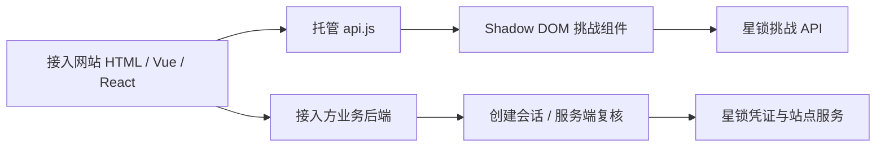

# 托管 SDK 与网站接入指南

0.8.0 以托管脚本为主要入口，Vue 与 React 组件提供加载封装。普通网页、Vue 和 React 页面共用同一份挑战界面；后端继续负责出题、校验、票据及服务端复核。此架构借鉴主流验证服务的接入形式，不表示安全能力与它们等同。

官网默认选中圆环旋转；选择题型即创建会话并在弹窗打开，完成挑战后自动复核演示请求。首页主视觉不自动遮挡，直接进入 `#experience` 时打开默认题。这个自动复核只属于官网演示，外部接入的 SDK 仍返回 token，由自己的业务后端复核。

## 项目网站

| 入口 | 内容 | 状态 |
| --- | --- | --- |
| Pages 交互 demo | 八种验证的浏览器试玩、换题与结果反馈 | [直接试玩](https://stardreamtech.github.io/projects/starlock/demo/) |
| 品牌首页 | 产品介绍、品牌素材、架构 | 本地可用 |
| 在线体验 | 圆环旋转、直线/曲线滑块、数字、字符、算术验证及自动后端复核 | 本地可用，Vue 封装加载托管脚本 |
| 开发接入 | 普通网页、Vue 与 React 示例切换 | 本地可用 |
| 独立接入示例 | 无框架页面跨源加载脚本和挑战 | 本地可用 |
| 独立文档页面 | 导航式 API 与部署文档 | 待实现，当前提供 Markdown |
| 图片集管理 | 系统图库、自定义批量上传、启停与默认选择 | `/admin` 本地可用；独立管理认证 |
| 站点控制台 | 站点、域名、密钥和策略 | 待实现，当前通过 CLI 管理 |

官网位于 `examples/playground`，独立示例位于 `examples/hosted`。两者可以构建为静态文件；开发代理不进入构建产物。公开上线时，演示业务后端需要单独设计，不能把开发模式和 `/demo/*` 直接部署为公共业务服务。

## 本地启动

先按 [README](../README.md) 启动 Redis 与 FastAPI，再分别运行：

```bash
npm run dev
```

```bash
npm run dev:hosted
```

- 官网：<http://127.0.0.1:5178/>
- 独立接入网页：<http://127.0.0.1:5179/>
- 托管脚本：<http://127.0.0.1:8018/sdk/v1/api.js>
- 图片集管理：<http://127.0.0.1:8018/admin>

`npm run dev` 会先构建托管脚本，之后修改托管组件需运行 `npm run build:sdk` 并刷新页面。`npm run build` 依次类型检查、构建 SDK、官网与独立示例，输出 `dist/sdk/v1/api.js`、`dist/playground`、`dist/hosted-example`。

独立示例只把 `/demo/*` 代理给演示业务后端；SDK 和 `/v1/challenges*` 直接访问不同端口的星锁服务。它验证的是实际的跨源接入，不是把 API 全部代理成同源。开发专用的两个演示站点标识彼此分开，旧演示站点数据保持原样。

## 选择交互题型

题型由接入方后端创建会话时选择：`challenge_type: "slider"`、`"bezier_slider"` 或 `"rotate"`。前端的 `StarLock.render()` 和 Vue 属性无需变化，托管 SDK 根据题面自动渲染；成功回调和服务端复核流程也相同。服务端已经绑定题型，浏览器不能切换题型降低要求。

`slider` 是直线空间路径，`bezier_slider` 是曲线空间路径；两种题型都支持独立的贝塞尔速度缓动与同步旋转。每题随机使用拼图、五角星、正方形或长方形，并生成 2–3 个缺口，其中只有一个位置与角度都匹配。SDK 提交手柄原始进度，由后端重算缓动、位置和角度，接入方无需自己实现这段计算。

圆环旋转支持品牌预设与原有随机几何两种图片来源。业务后端创建会话的请求示例（省略站点认证头；示例值需替换）：

```json
{
  "site_key": "site_example",
  "action": "register",
  "context_id": "context_example_123",
  "origin": "https://www.example.com",
  "challenge_type": "rotate",
  "rotation_source": "preset"
}
```

`preset` 为默认值，按后台默认图库随机抽图并改变整图方向（出厂 23 张、5 套系统图集，可换成自定义图库）；`procedural` 使用原有随机几何图案。`rotation_source` 仅适用于旋转题，刷新不会更换来源。它是业务后端配置，不是 `StarLock.render()`、Vue 或 React 的属性，也不允许在浏览器挑战请求中修改。演示页的切换按钮通过开发专用 `/demo/session` 创建新会话，正式接入应在自己的业务后端决定。

业务后端还可通过 `image_set_id` 指定图集（例如 `system-orbit`）；该配置仅适用于预设旋转和两种滑块。浏览器不能修改图集，刷新继续使用会话绑定的图集。未指定图集的滑块保留程序背景。[后台管理、上传与参数说明](image-sets.md)。

部署时连同 `assets/rotation/`、`server/assets/image-sets/`、`server/assets/admin/` 与 SQLite 数据库一起保存，后端读取系统或自定义图片生成题面 PNG；挑战响应不包含原始素材路径、素材编号或目标角度。预设图库公开且数量有限，不能据此宣称生产抗识别能力增强。[素材说明](rotation-assets.md)。

升级至本版时同步部署后端与 `0.8.0` SDK，并刷新脚本缓存；旧 `0.4` SDK 不支持变速与旋转，`0.5` SDK 不支持圆环题。新 SDK 仍可处理没有 `motion` 的旧挑战。详见 [坐标与安全布局约束](../README.md#7-直线与贝塞尔滑块已实现)。

新站点默认支持八种题型；旧站点保留原权限，使用 `cli.py set-site-types` 明确授权后才能使用新增题型，命令见 [README](../README.md#7-直线与贝塞尔滑块已实现)。刷新 SDK 时注意五分钟公共缓存；本地重建后重新加载浏览器。

## 交付边界



- `packages/core`：无框架依赖的协议和客户端状态机，仍可用于自行开发界面。
- `packages/browser`：共享加载器、普通网页挂载 API、挑战界面及其样式。构建后的经典脚本自带 Vue 运行时，接入网站无需安装 Vue。
- `packages/vue`：调用加载器和托管 API，处理挂载、属性变化、销毁与事件；不再把挑战界面打包进宿主应用。
- `packages/react`：React 18/19 客户端封装，处理 StrictMode、票据变化、卸载清理和最新回调。
- `server/verification/cors.py`：仅对挑战接口开放按站点来源授权的 CORS；不扩大后端特权接口的权限。

当前默认用顶层 dialog 展示挑战，内容与样式挂在 body 下的独立 Shadow DOM，容器只保留紧凑验证卡和隐藏 token，不随题面高度挤动表单。没有托管 iframe。远程脚本与宿主页面处于同一 JavaScript 权限范围，Shadow DOM 不是安全沙箱。反自动化判断和通过凭证仍必须由后端校验。

## 弹窗与显示方式

- `displayMode` 默认为 `popup`，点击验证卡打开；`autoOpen: true` 在挂载后直接打开，适合由接入方的题型选择等明确操作触发。`displayMode: 'inline'` 保留旧版嵌入界面。
- `open()` / `close()` 打开或收起；用户关闭、Esc、遮罩点击和显式 close 会触发 `onClose()`，成功自动关闭不触发该通知。关闭不清除有效 token，会话继续计时；在途答案仍可能完成。完全取消前端请求并移除资源请调用 `destroy()`，它不撤销已签发的服务端凭证。
- 弹窗的关闭按钮、遮罩、内部滚动和默认样式均由 SDK 提供。原生顶层 dialog 使背景控件不可交互，Tab 留在验证层，关闭后焦点回到触发控件。SDK 不写入业务页面 body 的 style。
- 需要浏览器支持 `HTMLDialogElement.showModal()`；不支持时给出错误，接入方可显式选用 inline。完整浏览器检查目前基于 Chromium，其他浏览器与真实手机待验证。
- Vue 提供 `display-mode`、`auto-open` 属性和 `close` 事件，React 对应 `displayMode`、`autoOpen` 和 `onClose`。两种组件 ref 均提供 `open()`、`close()` 和 `refresh()`。

## 普通网页接入

在页面引入托管脚本；正式部署把下面的本地地址替换为自己的 HTTPS 托管域名：

```html
<script src="http://127.0.0.1:8018/sdk/v1/api.js" defer></script>
<div id="captcha"></div>
```

在脚本加载完成、自己的业务后端返回会话后调用：

```javascript
const widget = window.StarLock.render('#captcha', {
  siteKey: session.site_key,
  sessionTicket: session.session_ticket,
  displayMode: 'popup', // 默认值；容器显示紧凑验证卡。
  autoOpen: false, // 也可在自己的按钮回调中调用 widget.open()。
  onSuccess({ token, expiresIn }) {
    // 将 token 随业务请求交给自己的后端复核。
  },
  onExpire() {
    // 清空待提交凭证；需要继续操作时请求新会话。
  },
  onError(code) {
    // 展示恢复提示或记录错误类别，不记录完整票据。
  }
});
```

`session` 来自接入方自己的业务接口。[完整本地片段](examples/HostedIntegration.html) 使用 `/demo/session`，正式接入需替换；[完整独立示例](../examples/hosted/main.js) 使用自定义题型卡片，包含弹窗、加载错误、表单提交和销毁处理，不使用原生 select。

`render` 的容器可以是 CSS 选择器或 HTMLElement。返回值提供：

| 方法 | 行为 |
| --- | --- |
| `getResponse()` | 返回当前 token；未通过、过期、重置或销毁后为空 |
| `open()` / `close()` | 打开或收起弹窗，关闭后仍保留有效 token |
| `refresh()` | 替换活跃会话的题目，通过后需要新会话 |
| `reset(sessionTicket?)` | 有新票据时重新初始化；无参数时刷新当前挑战 |
| `destroy()` | 取消请求、清理计时器、移除 body 浮层、验证卡与隐藏字段，可重复调用 |

组件会在容器内加入名为 `starlock-response` 的隐藏字段，放在业务表单内即可随 FormData 提交。它不会自动提交业务；成功回调也不能替代后端复核。同一容器不能重复挂载；销毁后可重新使用，多个容器可分别挂载。

## Vue 接入

[VueIntegration.vue](examples/VueIntegration.vue) 是参与类型检查的完整示例，并原样显示在官网：

```vue
<StarLock :site-key="siteKey" :session-ticket="sessionTicket"
  sdk-url="http://127.0.0.1:8018/sdk/v1/api.js"
  @success="onSuccess" @expire="onExpire" @error="onError" />
```

父页面在自己的后端创建会话后挂载组件。`success` 返回 `{ token, expiresIn }`，`expire` 通知清除待提交凭证，`error` 返回错误码。更换会话时父页面也应清空旧 token。卸载组件或改变票据会销毁旧实例；异步脚本加载完成时不会恢复已卸载的组件。

同页加载器合并相同 URL 的请求，失败会清理并允许重试，超时为 15 秒。一页只使用一个 SDK 脚本地址；需要访问多个 API 部署时复用这份运行时并分别配置 `apiBase`，不同时加载多个 SDK 版本。Vue 加载失败时会显示重新加载按钮。

npm 包目前仍是私有工作区源码，尚未发布，也未生成可独立安装的 npm 分发包。外部项目当前可通过普通脚本接入，或在本仓库工作区中使用 Vue / React 示例。

## React 接入

工作区包 `@starlock/react` 支持 React 18.2+ 与 React 19。[ReactIntegration.tsx](examples/ReactIntegration.tsx) 参与类型检查，并显示在官网的 React 接入标签中。

```tsx
import { StarLock } from '@starlock/react'

<StarLock
  siteKey={session.site_key}
  sessionTicket={session.session_ticket}
  sdkUrl="https://verify.example.com/sdk/v1/api.js"
  onSuccess={({ token }) => submitBusiness(token)}
  onExpire={() => clearToken()}
/>
```

示例域名需要替换为自己的托管地址，`session` 由业务后端创建。`onSuccess` 返回的 token 随业务请求交给后端复核。`onError(code)` 通知错误，`onClose()` 通知弹窗收起。

组件在客户端 Effect 中加载共享 SDK，入口包含 `use client`。卸载和更换会话会销毁对应实例，异步脚本响应不会恢复旧实例。StrictMode 的额外挂载清理可以正常执行；更新回调函数不会重建当前题目。SSR 阶段输出加载占位，浏览器挂载后创建验证码。

`displayMode`、`autoOpen`、`apiBase` 和 `nonce` 与普通脚本含义相同。React ref 可调用 `open()`、`close()`、`refresh()`，`className` 和 `style` 设置外层容器。加载失败时提供重新加载按钮。

运行 `npm run dev:hosted` 后打开 [React 示例](http://127.0.0.1:5179/react.html)，可在 StrictMode 下体验圆环和数字题，并实际调用演示业务后端复核。该示例与普通网页示例共用 5179 端口的来源授权。

## 地址和版本

| 配置 | 含义 | 默认行为 |
| --- | --- | --- |
| `sdkUrl` / Vue `sdk-url` | 托管脚本完整地址或同源路径 | Vue / React 使用 `(apiBase 或空串) + /sdk/v1/api.js` |
| `apiBase` / Vue `api-base` | API 基地址，不带尾部 `/` 和 `/v1` | 托管组件从脚本地址推导 |
| `displayMode` / Vue `display-mode` | `popup` 默认浮层；`inline` 显式嵌入 | 默认 `popup` |
| `autoOpen` / Vue `auto-open` | 挂载后直接打开，适合用户操作触发 | 默认关闭 |
| `nonce` / Vue `nonce` | 宿主 CSP 的 nonce | 加载脚本及组件样式沿用同一 nonce |

例如脚本为 `https://verify.example.com/sdk/v1/api.js`，默认 API 为 `https://verify.example.com/v1/*`；脚本为 `/starlock/sdk/v1/api.js`，默认 API 保留 `/starlock` 前缀。域名均为示例，尚未配置。若把脚本放到独立静态 CDN，需显式指定 API 的 HTTPS 地址。

显式 `apiBase: ''` 使用宿主网站同源 `/v1/*`；`'/starlock'` 可配合同源网关去掉前缀后转发。只有脚本地址与 API 部署不同或需要同源代理时才需覆盖默认值。内部 Uvicorn 端口不必暴露在正式公共 URL 中。

Vue 示例读取宿主项目自己的公开环境变量：

```dotenv
VITE_STARLOCK_SDK_URL=http://127.0.0.1:8018/sdk/v1/api.js
```

需要覆盖 API 时再设置 `VITE_STARLOCK_API_BASE`。SDK 自身不自动读取环境变量；`VITE_*` 会进入浏览器代码，不可保存 `site_secret`。[Vite 环境变量说明](https://vite.dev/guide/env-and-mode)

脚本路径中的 `v1` 表示接口兼容版本，不是不可变文件。当前脚本使用五分钟公共缓存，更新可能延迟到缓存过期；破坏兼容的升级须使用新主版本路径。`window.StarLock.version` 当前为 `0.8.0`。挑战与 token 响应仍为 `no-store`。生产 CDN 缓存更新与回滚尚未接入。

## CORS 与后端认证

站点登记精确 Origin：协议、域名、非默认端口。挑战接口的 OPTIONS 预检及响应只为启用站点的已登记来源返回允许头；只允许 POST 与 Content-Type，不允许 Authorization 请求头，不使用 cookie 凭据。实际挑战请求仍校验该票据绑定的站点与 Origin，一个站点获准跨源不意味着能使用另一站点的票据。

来源检查当前逐次读取站点表，禁用站点后实际请求即被拒绝，不依赖预检缓存失效。大规模站点表下的查询性能尚未压测。[FastAPI CORS 说明](https://fastapi.tiangolo.com/tutorial/cors/)

`/v1/sessions` 和 `/v1/siteverify` 不开放 CORS。业务后端持 `site_secret` 创建会话并保存 `context_id`；浏览器只得到 `site_key`、短期票据和通过后的 token。最终复核使用业务后端自己保存的 action 和 context_id，不能直接采用浏览器声明的上下文。完整请求体见 [模块与接入](implementation.md)。

业务执行与凭证消费是两次操作，接入方仍需保证业务幂等；复核响应丢失时当前需重新验证。

## 托管部署与 CSP

FastAPI 仅分发 `STARLOCK_SDK_DIRECTORY/v1/api.js`，默认目录为项目 `dist/sdk`，不会暴露其他源码或数据库。缺少构建文件时返回 `SDK_NOT_BUILT`。也可以把构建文件部署到静态服务/CDN，API 独立部署；本次未发布到公网。

生产需配置 HTTPS、Host 白名单、反向代理信任链及网关限流。页面 CSP 应允许托管脚本源、API 的 connect-src、验证码的 data: 图片，以及组件样式。严格 CSP 可为引入 SDK 的 script 配置 nonce，SDK 会把它传给 Shadow DOM 内的样式；Vue 使用同名 nonce 属性。不要依赖脚本混淆、Shadow DOM 或 CORS 作为身份认证。

实现参考：[Vite 库构建](https://vite.dev/guide/build#library-mode)、[Shadow DOM](https://developer.mozilla.org/en-US/docs/Web/API/Web_components/Using_shadow_DOM)。尚未交付 npm 发布、正式 CDN、托管 iframe、站点控制台及生产容量验证。
